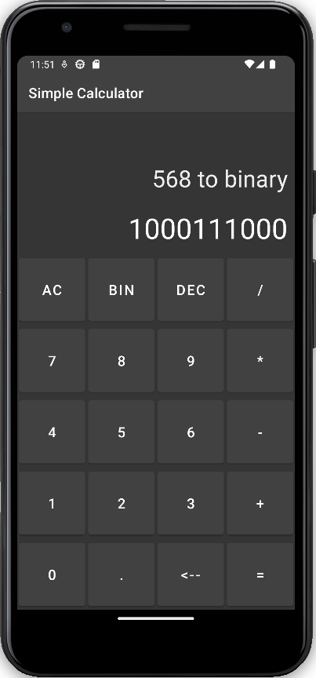
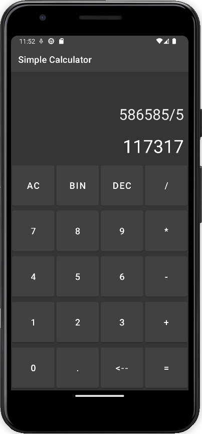

One certain day I was curious about android development. So I tried it and made this. Decided it was not for me, but that was fun! Kept for archival purposes.

# Simple Calculator
Prone to Floating Point Imprecision errors. Done merely as simple project to improve my Android Development knowledge

